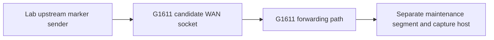

# Reproducing selected checks

This document describes the conditions, observations and acceptance criteria needed to assess this case on another owned unit. It is not a complete installation package: the original native DB adapter, deployment helpers, private configurations and firmware are not attached. Missing prerequisites are identified below rather than replaced with guessed commands.

## Coverage

| Goal | What this document provides | What still has to be supplied |
| --- | --- | --- |
| Compare hardware/software | Recorded platform profile and read-only inventory commands | Access to the reader's own unit; verified PCB observation |
| Explain CFG loading | Native paths, loader/decryptor names and primary/fallback behavior | Matching image and actual derivation inputs for an external codec |
| Reproduce a boot canary | Consumer fields, benign canary shape, before/after/rollback criteria | Validated native DB add/set/get/save/delete adapter for the exact build |
| Reproduce isolation acceptance testing | Two-segment topology, marker controls and carrier-event test | Verified port mapping, capture setup and local inverse for any topology change |
| Install the full maintenance service | Historical outcome and the dependencies that mattered | Reviewed launcher, binary/build provenance, enrollment and firewall integration |
| Decode a G1611 CFG with the utility | Pinned utility interface and explicit unclosed compatibility question | Valid G1611 fixture and verified format/parameter mapping |

## Record the environment first

Obtain access through a method validated for the exact unit. The historical factory-service work used the protocol family in the [F6107A implementation](https://github.com/Blinko1987/F6107A-telnet-root-on-AIS-fiber/tree/7d328a8a2a00da2f09d2a76ba6696def3fc79992); that is related-model source provenance, not a promise that its invocation or defaults apply to every G1611.

Once a shell is available, these read-only commands collect selected technical fields:

```sh
uname -sr
sed -n '/^Processor[[:space:]]*:/p;/^model name[[:space:]]*:/p;/^CPU architecture[[:space:]]*:/p;/^Hardware[[:space:]]*:/p' /proc/cpuinfo
sed -n '/^MemTotal:/p' /proc/meminfo
cat /proc/mtd
grep ' / ' /proc/mounts
ls -l /kmodule/mt7916.ko
wc -c < /userconfig/cfg/db_user_cfg.xml
```

These commands are provided for a compatible Linux/BusyBox environment; their whole sequence was not freshly executed on a router during publication preparation. A missing command/file is an environment observation, not proof of the opposite hardware capability. `uname -sr` omits the hostname; the selected CPU fields omit serial fields. Keep raw inventory private and publish only the selected platform facts.

Also record the vendor's separate hardware, firmware, extension and boot-software fields. Compare them individually with the [case profile](CASE-STUDY.md#device-and-software-under-investigation). Do not collapse them into one "firmware version". Identify the PCB from its product marking without publishing a photo containing labels, serials or optical/network credentials. UART voltage and pin assignment require their own measurements.

## Native configuration comparison

Distinguish a native saved CFG from a web-exported `config.bin`. Keep an exact private baseline before any change; neither a file extension nor the number 6 proves a match to the utility's container.

For the examined loader, check the primary and fallback path, the encryption/type dispatch, decryption, wrapper checks and XML validation as separate stages. The [mechanism note](MECHANISMS.md#native-configuration-loading) supplies the observed names and conclusions. Build-specific virtual addresses are intentionally not presented as universal offsets.

The utility baseline used for source comparison is commit `e3a1a7f56c2df26a02f52f72b16173d0702d9ad0`. With a private checkout and its documented dependencies available, `python3 examples/decode.py --help` establishes the available CLI. The [proposed upstream documentation](upstream/TYPE6-DOC-PROPOSAL.md) records the existing type-6 interface. No successful G1611 decode or encode is supplied by this case.

A future compatibility fixture must contain synthetic identity and credentials, have known expected decoded content, and be valid for the decoder path being tested. Arbitrary edits to encrypted bytes do not produce a valid anonymized fixture. Generic synthetic type-6 tests would test the utility, while a G1611 support claim additionally requires a demonstrated device-format mapping.

## Native startup canary

Prerequisites are a compatible native consumer, a writable executable mount, a validated DB adapter/save route, private baseline capture, and a verified way to remove only the test's owned row. A generic `sendcmd` recipe is not supplied because it was not established by the retained material used for this publication.

The canary can be a short uniquely named executable, for example `/Pluginlog/caseboot`. That illustrative path is not a copied private deployment path. Its contents can be as small as:

```sh
#!/bin/sh
cat /proc/uptime > /Pluginlog/caseboot.receipt
exit 0
```

Reserve unused paths first. Run the exact executable manually and verify prompt exit. Before the reboot test, remove only its old owned receipt so a manual execution cannot be mistaken for startup execution.

Using the validated native adapter, create one owned row with `CmdName` and `CmdInfo` both set to the complete short executable path, `TimeType=0`, and appropriate zero defaults for `Timer`, `TimeCount` and `CmdFlag`. Obtain the actual row identity and required `ViewName` from the adapter/schema rather than inventing them. Read the row back, save through the verified native route, and verify save completion.

After an authorized reboot, verify a distinct boot, the newly created receipt, the reloaded row and normal native startup. Then remove only the owned row through the same adapter, save, remove its owned files, and verify that a subsequent boot no longer executes it. Preserve pre-existing rows and configuration.

The launch path can time out after roughly eight seconds and perform first-token `killall` cleanup. A unique direct executable is therefore significant. A generic `/bin/sh` first token or a foreground daemon would change the risk and is not the tested canary shape. A persistent service also needs an idempotent background launcher; the consumer itself did not provide a respawn contract.

**Reproduction gap:** the native adapter's complete source and invocation/save/rollback sequence have not been published in this document set. Until they are supplied and checked, this section explains a measured mechanism and its test contract, not a copy-and-run persistence installer.

## Isolation acceptance test

Use a disconnected lab upstream segment and a separate maintenance segment. Identify the actual physical socket/interface mapping on the tested build. Preserve an independent maintenance path and a verified inverse before any temporary membership/role change.



1. Define a distinctive marker payload and count transmitted and received frames for a bounded trial. Keep endpoint addresses and capture files private.
2. Establish a positive control in a deliberately connected state, showing that the sender, path, capture and marker filter work. A zero count without a working control is inconclusive.
3. Apply the candidate temporary boundary through the already validated local operation. Check native role, Linux bridge membership, maintenance reachability and received marker count separately.
4. Restore the control state and repeat the positive control. This checks that a stopped sender or broken capture did not manufacture the earlier zero.
5. Reapply the candidate and test DHCP/egress independently. A lease or a few pings does not prove forwarding isolation.
6. Interrupt the actual physical carrier, verify carrier loss and restoration, then recheck roles, bridge state and markers. A software toggle alone does not reproduce a physical carrier event.
7. Test a distinct reboot separately. Restore the original state and cancel temporary recovery workers through their actual owned identities.

The historical temporary `nbif0` detachment passed one marker test but failed after a roughly five-second physical link loss. This document does not recommend it as a persistent gateway configuration. The historical counts are described in the [case study](CASE-STUDY.md#packet-tests-exposed-the-decisive-failure); a new test should report its own counts and conditions.

**Reproduction gap:** the original marker generator/capture parser and fully validated topology inverse are not bundled here. The method and acceptance conditions are available; exact script-level reproduction and a full service installation remain follow-up artifacts.
